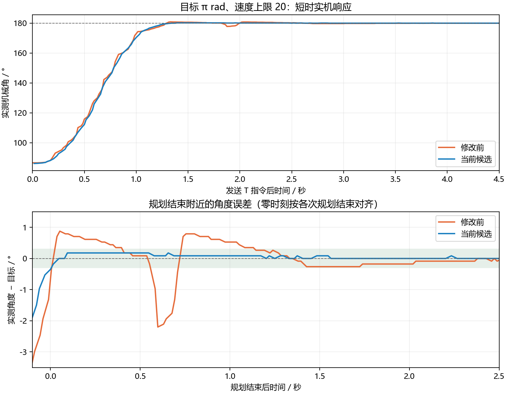

# π 附近到位振荡调参（2026-10-16）

用户在上一轮轨迹优化后继续反馈：运动有顿挫，到位后有时左右摆动约 3°、约 2Hz；
目标 π rad、速度上限 20 时最容易复现。用户释放网页串口后，本轮使用 COM8 采样并调参。

## 复现与调整依据

上一轮只记录每个小步 1.15 秒，且取 0.8～1.15 秒的摆幅，不能据此判断大角度到位后的
持续摆动。本轮改为单次目标指令后观察 4.5 秒，每次结束 D 并确认 EN=OFF。
初始电压上限仍为 3V，速度上限设为 L20；轨迹仍受 4rad/s / 4rad/s² 约束。

从约 1.511rad 发到 π 时，规划在约 1.277 秒结束，但实测角度继续发生约 3.08° 的摆动，
一度回退约 2.20°，随后再次跨过目标。约 1.1 秒后才持续进入 ±0.3° 范围，最终可以静止。
这复现了用户观察到的到位后摆动，说明只改善参考轨迹不足以抑制该现象。
回退和再次跨过目标的间隔接近用户描述的低频范围，但本轮未给出精确频率辨识。

增加了 `ref`、`rv`、`uq`、`ui` 诊断字段，用于区分规划位置/速度与实际反馈。
后续测试确认 `rv=0`、`ref` 固定后，仍可出现实际摆动。`uq` 是软件输出电压指令，
`ui` 是速度 PI 的积分输出，单位都是 V，不是电流读数。

降低位置 P 到 8、速度 I 到 2 的试验反而导致 π 附近持续更大的摆动，未采用。
其采样中输出指令未达到 3V 限幅，位置会先缓慢变化，再突然跳过目标，呈现粘滑等
非线性特征。不能将原因简单归结为输出限幅后的积分饱和，也未独立测定摩擦/齿槽参数。

最终候选增强比例反馈提供的位置恢复力和速度阻尼，同时减少积分作用和测速延迟：

| 参数 | 上一轮候选 | 当前候选 |
|---|---:|---:|
| 速度 P | 0.2 | 0.6 |
| 速度 I | 5 | 2 |
| 位置 P | 20 | 30 |
| 速度低通时间常数 | 0.05s | 0.02s |

没有改变固定零点、11 极对、电压上限、PWM、上电单圈或本轮前已有的梯形轨迹。
目前结果支持采用这组参数；未建立精确电机动力学模型，不能声称已唯一定位物理根因。

## 实机验证

当前候选经 Keil 编译、ST-Link 下载、STM32CubeProgrammer 逐段校验后测试。
每次使能约 4.5 秒，最后发送 D，确认 EN=OFF，并关闭串口。

| 测试 | 初始角度 | 规划结束后首秒摆幅 | 记录末一秒摆幅 |
|---|---:|---:|---:|
| 修改前 → π | 1.5110rad | 3.08° | 0.086° |
| 当前候选 → π | 1.5033rad | 0.53° | 0.086° |
| 当前候选 → 0 | 3.0618rad | 1.75° | 0.000° |
| 当前候选 → π | -0.0828rad | 0.35° | 0.000° |

首秒摆幅为规划结束起 1 秒内角度的最大值减最小值，包含到位收敛过程。
其中发到 0 的测试主要是残余跟随误差收敛，在约 0.5 秒后持续进入 ±0.3°。
它与反复跨过目标的周期摆动不同。修改前首秒摆幅约 3.08°，当前同方向、相近起点
约 0.53°；当前从 1.5033rad 发到 π 的最大正向超调约 0.18°。

另有 π 上侧约 3.6033rad 发到 π、以及约 3.0741rad 发到 1.5rad 的记录，也均最终收敛；
前者规划结束后仍需约 0.56 秒进入 ±0.3°，后者约 0.03 秒。
这些短时记录不能保证所有初始位置和负载下均无瞬态超调。



图中修改前规划结束时刻由当时梯形轨迹参数和起点估算；当前候选按首次报告 `rv=0`、
`ref=目标` 的采样确定。二者有一个查询周期级别的时间对齐误差，不适合做精确相位辨识。

采样约 37～44Hz，AS5600 计数分辨率约 0.088°；0.000° 表示该窗口未采到角度计数变化，
不代表没有微振动。未测声学噪声；缩短速度滤波并提高比例反馈可能改变听感，需用户确认。
用户还需体验真实手感，尤其是持续运动中的顿挫。本轮没有重新验证完整上电单圈。

CSV 原始数据：[measurements/2026-10-16-position-response](measurements/2026-10-16-position-response)。
测试脚本：[position_response.py](../tools/diagnostics/position_response.py)。该脚本实际会使能电机，
仅用于当前已确认可测试的硬件环境，执行 3V / L20 的有限时长位置测试，结束时失能。

## 构建与版本状态

ARMCC 5.06 全量构建 0 Error / 0 Warning；既有主机测试通过，覆盖轨迹、PWM、编码器、
PI 限幅、生命周期、故障、E/D 和前馈接入。主机 PI 对照使用当前配置参数，不是声称
新参数的静止输出与 `f888ddb` 数值完全一致；实机稳定性依据上述测量判断。

```text
Code=14176 RO-data=592 RW-data=68 ZI-data=3892
Flash=14836 bytes; RAM=3960 bytes（含栈和堆）
HEX SHA256=526DF1D6A787D357840A374CBC7EEDEEE4F4B3EDB81F91742D937B756388564D
```

当前烧录候选备份：`D:\dsh_build\releases\gimbal-damped-20261016`。
上一轮轨迹候选仍在 `D:\dsh_build\releases\gimbal-smooth-20261016`。
静音稳定基线 Git 提交仍为 `f888ddb`，备份目录 `D:\dsh_build\releases\gimbal-f888ddb`。
用户随后实测确认“有很明显改善”，授权将本轮及上一轮优化提交并推送。
本次将轨迹规划、到位反馈调参、测试和采样记录一起纳入版本管理，未覆盖稳定基线备份。
