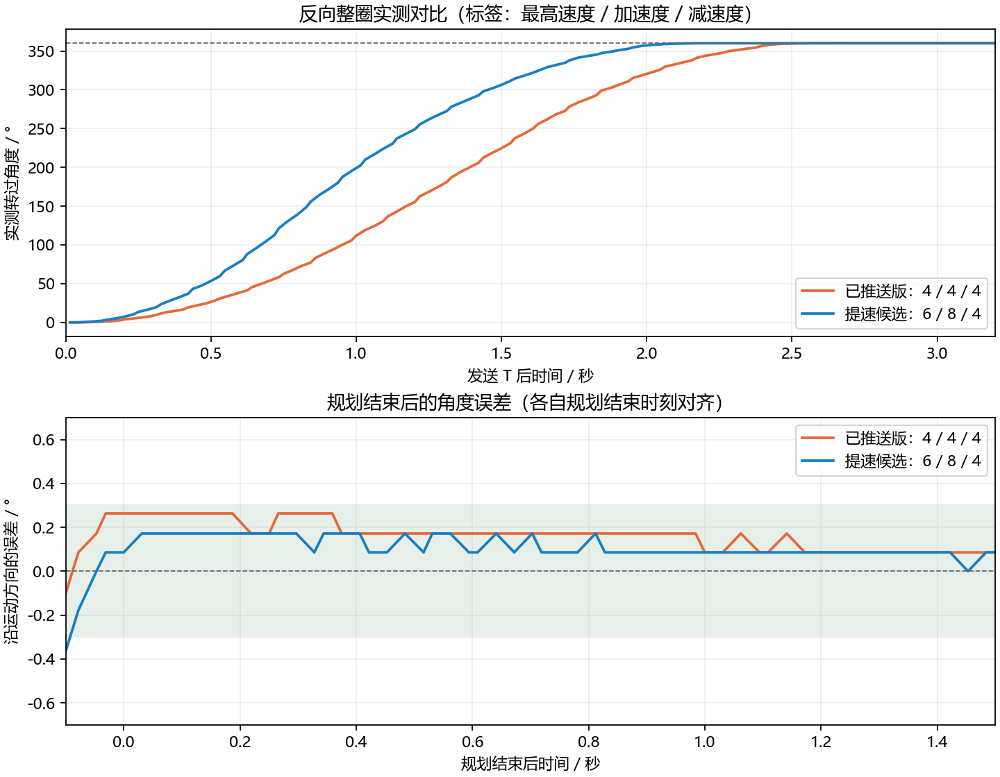

# 提速与柔和制动（2026-10-16）

> 本文保留提速阶段的参数与实测。后续末段收敛调参及当前板上版本见 [到位收敛优化](到位收敛优化-2026-10-16.md)。

用户确认上一版优化有明显改善，要求先提交、推送，再提高旋转速度并保持稳定和精度。
已将该版提交为 `8b74ca8` 并推送至 `origin/main`，包含轨迹规划、反馈调参、测试和实机采样。
原静音基线 `f888ddb` 也随同推送。本记录对应提交之后的提速候选，尚未提交。

## 当前实现

| 参数 | 已推送版 8b74ca8 | 本轮提速候选 |
|---|---:|---:|
| 规划最高速度 | 4rad/s | 6rad/s |
| 规划加速度 | 4rad/s² | 8rad/s² |
| 规划减速度 | 4rad/s² | 4rad/s²，独立参数 |
| 速度 PI / 位置 P / 测速滤波 | 0.6 / 2；30；0.02s | 同左 |

增加 `MOTOR_TARGET_DECEL`，加速和减速分别规划；保留已验证的制动强度，较早开始减速。
短行程到不了最高速度时自动采用三角形速度曲线。规划速度仍服从 L，例如 L2 将参考速度
限制在 2rad/s；L20 时参考速度上限为 6rad/s。上述限制针对规划值，不是实测速度硬保证。
当前正反整圈采样中的滤波速度峰值约 5.95 / 6.08rad/s。

新公式支持不同加减速度、运动中改目标、先制动再反向、制动距离内目标和降低 L。
急停 D 仍立即失能，不等待轨迹减速。上电自检仍使用原来的 4rad/s 开环单圈流程；
本轮提速仅针对普通网页/串口位置指令，不改变自检。

扩展高速反向用例时发现：逐次用 float 累加位置，在长时间低速巡航后会产生微小终点
修正跳变。用例捕获到约 0.0005rad 的最后一步变化超出当步应有运动范围。
改为从每段的起点、起速和累计时间直接计算位置/速度，段内累计时间及中间值用 double，
避免把微小位移反复累加到多圈绝对位置。输出接口仍为 float。
±100rad 附近、长慢速巡航和快速制动返回等回归测试均通过，未放宽原有连续性容差。

## 实机验证

COM8 / 115200、3V、L20，每次使能约 4.5 秒后 D，确认 EN=OFF。下载由 ST-Link / 
STM32CubeProgrammer 校验通过。测试脚本增加 `--delta`，可在多圈位置执行相对角度动作。

| 动作 | 规划结束时刻 | 首次持续进入目标 ±0.3° 的时刻 | 末一秒摆幅 |
|---|---:|---:|---:|
| 已推送版，反向整圈 | 2.61s | 2.50s | 0.086° |
| 提速候选，正向整圈 | 2.20s | 2.14s | 0.086° |
| 提速候选，反向整圈 | 2.20s | 2.13s | 0.086° |
| 提速候选，约 -0.083rad → π | 1.59s | 1.56s | 0.000° |

新候选整圈规划时间比已推送版缩短约 16%。反向整圈进入并持续保持在 ±0.3° 的实测时间
从约 2.50 秒降至 2.13 秒，缩短约 15%；有限次测试、不同机械起点，不代表所有工况。
正反整圈最大采样超调约 0.086° / 0.172°。最后一秒摆幅均约一个编码器计数。

同时测试了约 2.527rad → 0：最终准确收敛，但存在约 1.58° 短暂超调，规划结束后约
0.52 秒才持续进入 ±0.3°。该测试的最终一秒未采到计数变化。不能宣称所有位置都无瞬态
超调；π 目标和正反整圈表现较好，零点附近到位过程仍有改善空间。

本轮最初尝试 6rad/s、加减速度均为 8rad/s²，整圈规划更快（约 1.83s），但有一次测试
到约 2.69s 才稳定在 ±0.3° 内，未作为最终参数。采用独立减速度后兼顾了速度和收敛。



原始 CSV 及统计：[measurements/2026-10-16-speed](measurements/2026-10-16-speed)。
图中角度按运动方向显示转过角度；误差图按各自首次报告规划结束的采样对齐。
采样约 37Hz，时间精度受串口传输和查询周期影响；AS5600 一个计数约 0.088°。
0.000° 表示显示分辨率内未变化，不代表机械完全没有微振动。本轮没有测量噪声或电流，
最终手感仍待用户确认；不以软件 uq 指令值代替实测电流。

## 构建与回退

Keil ARMCC 5.06 全量构建：0 Error / 0 Warning。

```text
Code=14540 RO-data=592 RW-data=68 ZI-data=3924
Flash=15200 bytes; RAM=3992 bytes（含栈和堆）
HEX SHA256=17A07BBA5DFE6FAB5701FBF3622E8680965D8D1BED64188A20580EC9D57CB833
```

主机测试通过：294 组终点/速度/加速度/变步长用例，生产参数下连续重规划与降速，
长慢速巡航、±100rad 附近参考位置连续性，以及既有控制/故障回归测试。
主机测试验证轨迹算法，真实电机的稳定性依据有限次实机记录判断。

当前板上为本轮提速候选，备份：`D:\dsh_build\releases\gimbal-fast-20261016`。
用户确认的上一版：Git `8b74ca8`，HEX / AXF 备份在 `D:\dsh_build\releases\gimbal-8b74ca8`，
其 HEX 哈希仍为 `526DF1D6A787D357840A374CBC7EEDEEE4F4B3EDB81F91742D937B756388564D`。
需要回退可下载该备份；本轮提速修改与已推送版本分开保留。
